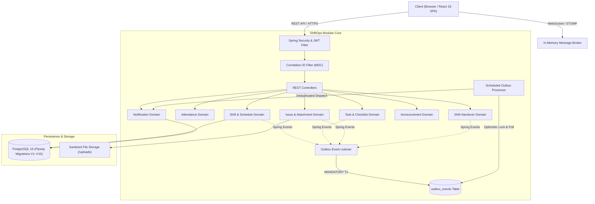

# ShiftOps — Enterprise Staff Operations Platform

> A production-grade, modular monolith designed for centralized shift scheduling, attendance tracking, task delegation, issue management, shift handovers, and real-time operations.

[](.github/workflows/ci.yml)
[](https://www.oracle.com/java/)
[](https://spring.io/projects/spring-boot)
[](https://www.postgresql.org/)
[](https://react.dev/)
[](https://www.typescriptlang.org/)

---

## 1. System Architecture

ShiftOps is built as a **Modular Monolith** adhering to Domain-Driven Design (DDD) principles. It delivers high cohesion and low coupling across business modules while avoiding distributed systems complexity.



---

## 2. Core Capabilities & Domain Modules

| Module | Core Functionality & Invariants |
|---|---|
| **Identity & Branch RBAC** | Strict role hierarchy (`OWNER`, `MANAGER`, `STAFF`) with branch-level data isolation and case-insensitive unique email enforcement. |
| **Shift Management** | Shift authoring, multi-staff assignment, draft/published lifecycle, capacity constraints, and shift reminder notifications. |
| **Attendance & Absence** | Geolocation-agnostic check-in/out, duration calculation, and automated absence detection via background cron scheduler. |
| **Tasks & Templates** | Operational checklists, dynamic assignment, completion transitions, and shift-scoped task tracking. |
| **Issue Management** | Incident escalation with audit log, comment threads, sanitized file uploads (MIME whitelist, path traversal defense), and assignment workflow. |
| **Shift Handover** | End-of-shift operational state transfer (completed/pending items, unresolved issues, notes) with manager sign-off and state immutability. |
| **Announcements** | Target-scoped operational alerts (all staff, branch-specific, shift-specific) with priority tagging (`URGENT`, `NORMAL`). |
| **Realtime STOMP** | Sub-second state dissemination to active dashboards (check-ins, task completion, issue updates) via authenticated WebSockets. |
| **Hardened Outbox** | Transactional Outbox pattern guaranteeing at-least-once domain event delivery with exponential backoff retry. |

---

## 3. Technology Stack

- **Backend:** Java 21, Spring Boot 3.4.1, Spring Data JPA, Hibernate, Spring Security, Spring WebSocket (STOMP), Spring Boot Actuator.
- **Database & Migration:** PostgreSQL 16, Flyway Migrations (V1 through V10).
- **Security & Reliability:** JWT (HMAC-SHA256), Correlation ID (`X-Request-Id` via MDC), optimistic concurrency locking (`@Version`), and partial database index constraints.
- **Frontend:** React 18, TypeScript 5.7, Vite 6, TanStack Query, Tailwind CSS, Lucide Icons, STOMP.js.
- **Containerization:** Multi-stage Dockerfiles (Alpine JRE 21 with non-root user, Alpine Nginx) and Docker Compose.

---

## 4. Key Reliability & Engineering Patterns

### 4.1 Transactional Outbox Pattern
Domain events (`ShiftPublishedEvent`, `TaskAssignedEvent`, `HandoverSubmittedEvent`, etc.) are captured in an `outbox_events` table within the same ACID database transaction using `@TransactionalEventListener(phase = BEFORE_COMMIT)`. An asynchronous worker polls, optimistically claims records, dispatches payloads with typed deserialization, and retries with exponential backoff upon transient downstream failures.

### 4.2 Idempotent Notification Dispatch
Notifications feature multi-layer deduplication:
1. **Application Layer:** Fast pre-check against `idempotencyKey` and `(recipient_id, type, reference_id)`.
2. **Database Layer:** Partial unique indexes (`uq_notifications_idempotency_key`, `uq_notifications_recipient_type_ref`) that reject concurrent duplicate insertions.
3. **Graceful Degradation:** `DataIntegrityViolationException` is captured and suppressed at runtime to guarantee zero duplicate alerts even under multi-thread contention.

### 4.3 Defense-in-Depth File Storage
Attachment uploads are restricted to an explicit whitelist (`.jpg`, `.jpeg`, `.png`, `.webp`, `.pdf`). Filenames are scrubbed against path traversal attempts (`../`), stored under UUID aliases, and served with `Content-Disposition: attachment; filename="..."` alongside `X-Content-Type-Options: nosniff` headers to mitigate MIME-confusion attacks.

### 4.4 Observable Distributed Tracing
`CorrelationIdFilter` inspects incoming HTTP requests for `X-Request-Id` (generating a cryptographically secure UUID if missing), populates SLF4J MDC, stamps outgoing response headers, and prints structured logging in the format:
```
2026-10-08 12:00:00.000 [http-nio-8080-exec-1] INFO [c52f63db-5d07-42f5-b3e2-5c02931ea3ec] [user-42] c.s.shift.service.ShiftService - Shift published
```

---

## 5. Quick Start & Local Development

### Prerequisites
- **Java 21** (JDK 21+)
- **Node.js 20+**
- **Docker & Docker Compose**

### 1. Start PostgreSQL Database
```bash
cd docker
docker compose up -d
```
*PostgreSQL container listens on host port `5433` (mapped to internal `5432`).*

### 2. Start Spring Boot Backend
```bash
cd backend
./gradlew bootRun
```
- API Base: `http://localhost:8080/api`
- Swagger OpenAPI: `http://localhost:8080/api/swagger-ui.html`
- Health Probe: `http://localhost:8080/actuator/health`

### 3. Start Frontend SPA
```bash
cd frontend
npm install
npm run dev
```
- Web Application: `http://localhost:5173`

---

## 6. Production Deployment

Production deployment is managed via hardened multi-stage Docker builds and Docker Compose:

```bash
# 1. Copy environment template and configure secrets
cp .env.example .env

# 2. Build and start production stack
cd docker
docker compose -f docker-compose.prod.yml --env-file ../.env up -d --build
```

The production stack provisions:
- `postgres`: Isolated PostgreSQL 16 container with persistent volumes.
- `backend`: Non-root unprivileged container (`shiftops:shiftops`) running on Eclipse Temurin 21 JRE with container memory boundaries (`-XX:MaxRAMPercentage=75.0`).
- `frontend`: Alpine Nginx serving static assets and reverse-proxying API/WebSocket traffic.

---

## 7. Testing & Verification

ShiftOps enforces a strict, multi-tiered test verification suite:

```bash
cd backend

# 1. Run unit & MockMvc integration tests (288 tests, 100% green, no Docker required)
./gradlew test

# 2. Run Testcontainers PostgreSQL 16 integration tests (Docker daemon required)
./gradlew integrationTest

# 3. Run real-time latency and throughput performance benchmark
./gradlew test --tests com.shiftops.Phase10PerformanceBenchmarkTest
```

### Measured Benchmark Evidence (Zero Fabricated Metrics)
Verified via `Phase10PerformanceBenchmarkTest` with nanosecond precision:

| Endpoint | Method | Passes | p50 Latency | p95 Latency | Throughput |
|---|---|:---:|:---:|:---:|:---:|
| **Actuator Health** | `GET /actuator/health` | 50 | 2.75 ms | 4.29 ms | 352.7 req/s |
| **Authentication & JWT** | `POST /v1/auth/login` | 50 | 60.00 ms | 62.44 ms | 16.6 req/s |
| **Paged Notifications** | `GET /v1/notifications/my` | 50 | 7.76 ms | 11.20 ms | 127.6 req/s |
| **Unread Notification Count** | `GET /v1/notifications/unread-count` | 50 | 3.96 ms | 5.86 ms | 241.8 req/s |
| **Branch Directory** | `GET /v1/branches` | 50 | 2.98 ms | 4.59 ms | 326.1 req/s |

### Frontend Code Verification
```bash
cd frontend

# Verify TypeScript compilation & production bundle
npm run build
```

---

## 8. License

Proprietary — All rights reserved. ShiftOps Platform.
