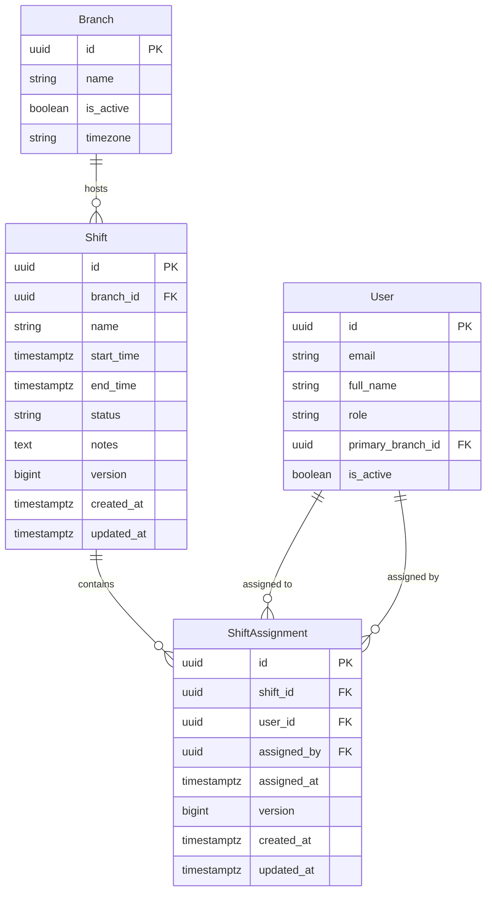
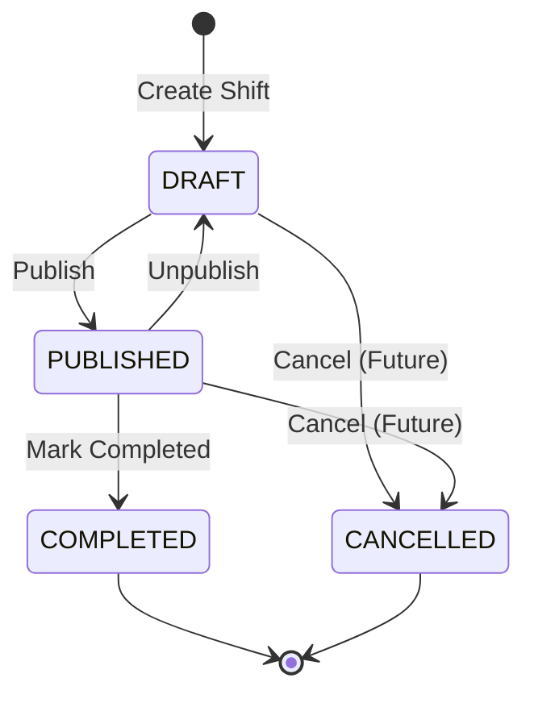

# Phase 3 Design Document: Shift Scheduling

## 1. Executive Summary & Goals
The objective of Phase 3 is to implement flexible, conflict-safe shift scheduling for ShiftOps.
Key goals include:
- Establishing the `Shift` and `ShiftAssignment` entities linked to `Branch` and `User`.
- First-class support for overnight shifts crossing midnight (e.g. 22:00 -> 06:00 next day).
- Rigorous interval overlap detection preventing double-booking of staff.
- Strict role-based authorization and branch isolation (`OWNER`, `MANAGER`, `STAFF`).
- Concurrency control preventing race conditions when assigning staff or modifying shift states.
- Clean REST API contracts with extensive validation and expressive error codes.

---

## 2. Domain Model & Entities



### 2.1 Shift Entity (`shifts`)
- `id` (UUID, PK)
- `branch` (`@ManyToOne` -> `Branch`, FK `branch_id`, NOT NULL): The operating branch where the shift occurs.
- `name` (VARCHAR(100), optional): Descriptive label (e.g., "Morning Shift", "Overnight Security", "Bar Closing").
- `startTime` (TIMESTAMPTZ / `Instant`, NOT NULL): Absolute start timestamp.
- `endTime` (TIMESTAMPTZ / `Instant`, NOT NULL): Absolute end timestamp.
- `status` (`ShiftStatus` enum: `DRAFT`, `PUBLISHED`, `COMPLETED`, `CANCELLED`): Current state of the shift.
- `notes` (TEXT, optional): Shift instructions or operational briefing.
- `assignments` (`@OneToMany` -> `ShiftAssignment`, cascade ALL, orphanRemoval true).
- `createdAt`, `updatedAt`, `version` (from `BaseEntity`).

### 2.2 ShiftAssignment Entity (`shift_assignments`)
- `id` (UUID, PK)
- `shift` (`@ManyToOne` -> `Shift`, FK `shift_id`, NOT NULL): Target shift.
- `user` (`@ManyToOne` -> `User`, FK `user_id`, NOT NULL): Assigned staff member.
- `assignedBy` (`@ManyToOne` -> `User`, FK `assigned_by`, NOT NULL): Manager or Owner who made the assignment.
- `assignedAt` (TIMESTAMPTZ / `Instant`, NOT NULL): Time assignment was made.
- `createdAt`, `updatedAt`, `version` (from `BaseEntity`).

---

## 3. Shift Lifecycle & State Machine



### 3.1 State Definitions
1. **`DRAFT`**:
   - Initial state upon creation.
   - Visible **only** to `OWNER` and `MANAGER` of the branch.
   - Fully mutable: times, branch, name, notes, and staff assignments can be modified.
   - `STAFF` cannot see or query draft shifts.
2. **`PUBLISHED`**:
   - Shift schedule is finalized and visible to assigned staff members.
   - Visible to `STAFF` who are assigned to this shift.
   - **Modification restrictions**: Once published, `startTime`, `endTime`, and `branch` cannot be modified directly without reverting to `DRAFT` first. This guarantees that staff expectations are not disrupted and future attendance clocks are anchored accurately.
   - Staff assignments can still be added or removed (with overlap validation).
3. **`COMPLETED`**:
   - The shift has concluded.
   - Fully read-only: no assignments, unassignments, or updates permitted.
4. **`CANCELLED`** (Extensibility):
   - Designed into the status enum and database CHECK constraint so future cancellation workflows can be added without altering the database schema.

---

## 4. Overnight Shift Handling

### 4.1 Concept & Problem Statement
In retail, hospitality, and healthcare, shifts routinely span midnight (e.g. 22:00 to 06:00). Storing shift times merely as `time` without dates (e.g., `22:00` and `06:00`) causes ambiguities because `22:00 > 06:00`.

### 4.2 Solution Architecture
ShiftOps models `startTime` and `endTime` as UTC absolute timestamps (`TIMESTAMPTZ` in PostgreSQL, `java.time.Instant` in Spring Boot):
- Example overnight shift:
  - `startTime`: `2026-10-07T22:00:00Z`
  - `endTime`: `2026-10-08T06:00:00Z`
- Both points lie on a continuous linear timeline.
- Because `startTime` is `Instant.parse("2026-10-07T22:00:00Z")` and `endTime` is `Instant.parse("2026-10-08T06:00:00Z")`, the fundamental property:
  $$\text{startTime} < \text{endTime}$$
  remains universally true.
- Midnight is just an ordinary point on the continuous timeline with zero discontinuity.

---

## 5. Overlap Detection Engine

### 5.1 Mathematical Definition
Let Shift $A$ be defined as the half-open interval $[A_{start}, A_{end})$ and Shift $B$ as $[B_{start}, B_{end})$.
Two shifts overlap if and only if their intersection is non-empty:
$$[A_{start}, A_{end}) \cap [B_{start}, B_{end}) \neq \emptyset$$

This condition is satisfied if and only if:
$$\max(A_{start}, B_{start}) < \min(A_{end}, B_{end})$$

Which decomposes into two simultaneous boolean conditions:
$$A_{start} < B_{end} \quad \text{AND} \quad B_{start} < A_{end}$$

### 5.2 Proof of Correctness for Normal and Overnight Shifts
1. **Why half-open intervals $[start, end)$?**
   Shifts are scheduled such that if Shift 1 ends at 14:00 and Shift 2 starts at 14:00, the staff member can transition between them without a double-booking conflict.
   - With $A = [08:00, 14:00)$ and $B = [14:00, 20:00)$:
     - $A_{start} (08:00) < B_{end} (20:00)$ is TRUE.
     - $B_{start} (14:00) < A_{end} (14:00)$ is **FALSE**.
     - Therefore, no overlap! Touching at the exact boundary is permitted.
2. **Standard Day Overlap:**
   - $A = [08:00, 16:00)$ and $B = [14:00, 22:00)$:
     - $A_{start} (08:00) < B_{end} (22:00)$ is TRUE.
     - $B_{start} (14:00) < A_{end} (16:00)$ is TRUE.
     - Both TRUE $\Rightarrow$ Overlap detected from 14:00 to 16:00!
3. **Overnight Shift Overlap:**
   - $A = [2026\text{-}10\text{-}07\text{ }22:00,\text{ }2026\text{-}10\text{-}08\text{ }06:00)$
   - $B = [2026\text{-}10\text{-}08\text{ }05:00,\text{ }2026\text{-}10\text{-}08\text{ }13:00)$
     - $A_{start} (\text{Oct 7 } 22:00) < B_{end} (\text{Oct 8 } 13:00)$ is TRUE.
     - $B_{start} (\text{Oct 8 } 05:00) < A_{end} (\text{Oct 8 } 06:00)$ is TRUE.
     - Both TRUE $\Rightarrow$ Overlap detected!
4. **Non-Overlapping Overnight and Morning Shift:**
   - $A = [2026\text{-}10\text{-}07\text{ }22:00,\text{ }2026\text{-}10\text{-}08\text{ }06:00)$
   - $B = [2026\text{-}10\text{-}08\text{ }06:00,\text{ }2026\text{-}10\text{-}08\text{ }14:00)$
     - $B_{start} (\text{Oct 8 } 06:00) < A_{end} (\text{Oct 8 } 06:00)$ is FALSE.
     - $\Rightarrow$ No overlap!

### 5.3 Overlap Query Implementation
When assigning User $U$ to Shift $S_{new}$ with interval $[S_{start}, S_{end})$:
```sql
SELECT COUNT(sa) FROM shift_assignments sa
JOIN shifts s ON sa.shift_id = s.id
WHERE sa.user_id = :userId
  AND s.id != :targetShiftId
  AND s.status != 'CANCELLED'
  AND s.start_time < :newEndTime
  AND s.end_time > :newStartTime
```
If count > 0, an overlap conflict exists and the assignment is rejected with a 409 Conflict / 422 Unprocessable Entity error (`SHIFT_OVERLAP_CONFLICT`).

---

## 6. Concurrency & Race-Condition Analysis

### 6.1 Concurrent Assignment Race Condition
**Hazard**: Two managers simultaneously attempt to assign the same staff member Charlie to two different shifts that overlap in time.
**Failure mode**: Both transactions read existing assignments concurrently, find no conflict, and both insert their assignments. Charlie is double-booked.
**Mitigation Strategy**:
1. **Serialization via Pessimistic Row Lock on User**:
   During assignment creation, the service executes:
   `SELECT u FROM User u WHERE u.id = :userId` with `LockModeType.PESSIMISTIC_WRITE` (SQL `SELECT ... FOR UPDATE`).
   This serializes all concurrent assignment checks for the same staff member. The second transaction waits for the first transaction to commit before executing its overlap check.
2. **Database Unique Constraint**:
   `CONSTRAINT uk_shift_assignments_shift_user UNIQUE (shift_id, user_id)` guarantees that assigning the same user to the same shift twice is impossible at the database level.
3. **Optimistic Locking**:
   Both `Shift` and `ShiftAssignment` inherit `@Version` from `BaseEntity`. Concurrent modifications to the same shift trigger `OptimisticLockingFailureException`.

---

## 7. Database Constraints & Indexes

```sql
-- V3__create_shifts_and_assignments.sql

CREATE TABLE shifts (
    id UUID PRIMARY KEY DEFAULT gen_random_uuid(),
    branch_id UUID NOT NULL,
    name VARCHAR(100),
    start_time TIMESTAMPTZ NOT NULL,
    end_time TIMESTAMPTZ NOT NULL,
    status VARCHAR(20) NOT NULL DEFAULT 'DRAFT',
    notes TEXT,
    created_at TIMESTAMPTZ NOT NULL DEFAULT CURRENT_TIMESTAMP,
    updated_at TIMESTAMPTZ NOT NULL DEFAULT CURRENT_TIMESTAMP,
    version BIGINT NOT NULL DEFAULT 0,
    CONSTRAINT fk_shifts_branch FOREIGN KEY (branch_id) REFERENCES branches (id) ON DELETE RESTRICT,
    CONSTRAINT chk_shifts_status CHECK (status IN ('DRAFT', 'PUBLISHED', 'COMPLETED', 'CANCELLED')),
    CONSTRAINT chk_shifts_time_range CHECK (start_time < end_time)
);

CREATE INDEX idx_shifts_branch ON shifts (branch_id);
CREATE INDEX idx_shifts_status ON shifts (status);
CREATE INDEX idx_shifts_times ON shifts (start_time, end_time);
CREATE INDEX idx_shifts_branch_times ON shifts (branch_id, start_time, end_time);

CREATE TABLE shift_assignments (
    id UUID PRIMARY KEY DEFAULT gen_random_uuid(),
    shift_id UUID NOT NULL,
    user_id UUID NOT NULL,
    assigned_by UUID NOT NULL,
    assigned_at TIMESTAMPTZ NOT NULL DEFAULT CURRENT_TIMESTAMP,
    created_at TIMESTAMPTZ NOT NULL DEFAULT CURRENT_TIMESTAMP,
    updated_at TIMESTAMPTZ NOT NULL DEFAULT CURRENT_TIMESTAMP,
    version BIGINT NOT NULL DEFAULT 0,
    CONSTRAINT fk_shift_assignments_shift FOREIGN KEY (shift_id) REFERENCES shifts (id) ON DELETE CASCADE,
    CONSTRAINT fk_shift_assignments_user FOREIGN KEY (user_id) REFERENCES users (id) ON DELETE RESTRICT,
    CONSTRAINT fk_shift_assignments_assigned_by FOREIGN KEY (assigned_by) REFERENCES users (id) ON DELETE RESTRICT,
    CONSTRAINT uk_shift_assignments_shift_user UNIQUE (shift_id, user_id)
);

CREATE INDEX idx_shift_assignments_shift ON shift_assignments (shift_id);
CREATE INDEX idx_shift_assignments_user ON shift_assignments (user_id);
```

---

## 8. Role-Based Authorization Matrix

| Action | OWNER | MANAGER | STAFF |
|---|---|---|---|
| Create shift in branch | Any active branch | Assigned branch only | ❌ 403 Forbidden |
| List shifts in branch | Any branch (Draft & Published) | Assigned branch only (Draft & Published) | Assigned branch only, **PUBLISHED only**, assigned to self |
| View shift details | Any branch | Assigned branch only | Assigned shift only, **PUBLISHED only** |
| Update shift details | Any branch (Draft only for times) | Assigned branch (Draft only for times) | ❌ 403 Forbidden |
| Publish / unpublish shift | Any branch | Assigned branch only | ❌ 403 Forbidden |
| Complete shift | Any branch | Assigned branch only | ❌ 403 Forbidden |
| Assign staff to shift | Any branch (checks overlap) | Assigned branch only (checks overlap) | ❌ 403 Forbidden |
| Remove staff assignment | Any branch | Assigned branch only | ❌ 403 Forbidden |
| View my assigned shifts (`/my-shifts`) | Available | Available | **Primary endpoint for staff** (published only) |

---

## 9. REST API Contract

### 9.1 Shifts Endpoints
- `POST /api/v1/branches/{branchId}/shifts`: Create shift (`CreateShiftRequest`).
- `GET /api/v1/branches/{branchId}/shifts`: List shifts with filters (`startDate`, `endDate`, `status`).
- `GET /api/v1/shifts/{id}`: Get shift detail with assigned staff.
- `PUT /api/v1/shifts/{id}`: Update shift (`UpdateShiftRequest`).
- `PATCH /api/v1/shifts/{id}/status`: Transition status (`UpdateShiftStatusRequest`).
- `DELETE /api/v1/shifts/{id}`: Delete draft shift.

### 9.2 Shift Assignment Endpoints
- `POST /api/v1/shifts/{id}/assignments`: Assign staff (`AssignStaffRequest`).
- `DELETE /api/v1/shifts/{id}/assignments/{userId}`: Remove staff assignment.

### 9.3 Staff Self-Service Endpoints
- `GET /api/v1/shifts/my-shifts`: List published shifts assigned to caller in date range (`startDate`, `endDate`).

---

## 10. Validation Rules & Edge Cases

1. **`start_time < end_time`**: Validated by `@AssertTrue` in DTO, business service, and database `CHECK` constraint.
2. **Branch Inactivity**: Creating shifts in inactive branches is rejected (`BRANCH_INACTIVE`).
3. **Staff Inactivity**: Inactive staff cannot be assigned to shifts (`USER_INACTIVE`).
4. **Cross-Branch Assignment**:
   - Manager cannot assign staff belonging to another branch to their shift.
   - Staff must belong to the branch hosting the shift.
5. **Overnight Shifts**: Handled seamlessly via UTC timestamps.
6. **State Immutability**:
   - Cannot modify `startTime` / `endTime` on `PUBLISHED` or `COMPLETED` shifts.
   - Cannot add assignments to `COMPLETED` shifts.
7. **Duplicate Assignment**:
   - Handled at service level with readable error and at DB level by unique constraint.
