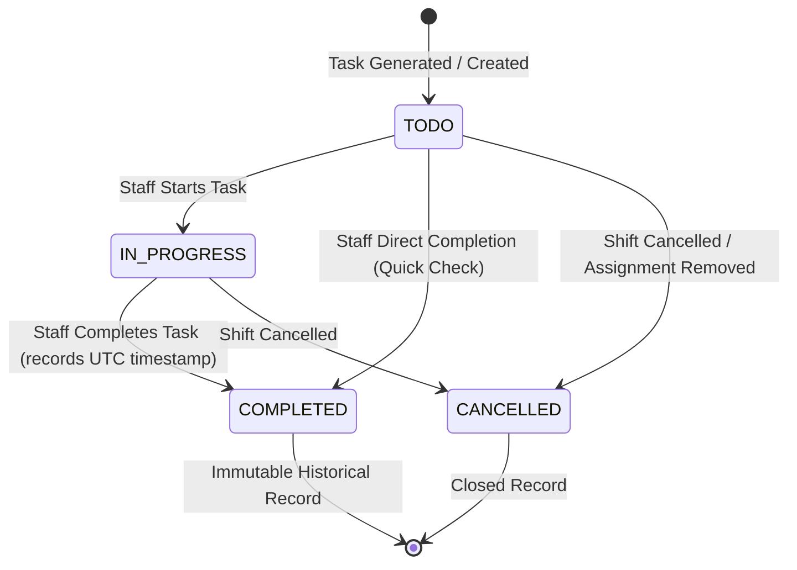

# ShiftOps — Phase 5: Task Assignment & Task Templates Design

> **Document:** `docs/phase5-design.md`  
> **Status:** APPROVED FOR IMPLEMENTATION  
> **Scope:** Phase 5 (Task Assignment & Task Templates)  
> **Date:** 2026-10-07  

---

## 1. Executive Summary & Core Business Purpose

In small business operations (cafes, retail stores, clinics, restaurants), staff need clear, unambiguous operational duties during their scheduled work shifts (e.g., opening checklists, sanitation routines, cash drawer reconciliations, closing procedures). Currently, these duties are communicated informally via chat groups or printed paper checklists, leading to missed steps, zero accountability, and poor managerial oversight.

ShiftOps Phase 5 introduces **Task Templates** and **Shift-bound Tasks**.
The workflow directly mirrors real-world business operations:
```
Branch
  └── TaskTemplate (reusable operational blueprint, branch-scoped)
        └── TaskTemplateItem (ordered list of checklist items with priority)

Branch
  └── Shift
        └── ShiftAssignment (staff member assigned to shift)
              └── Task (concrete task instance assigned to this staff member for this shift)
```

**Key Architectural Boundaries:**
- ShiftOps is **NOT** a generic Jira/Trello project management platform or ticket tracker.
- Tasks are strictly operational checklists bound to a staff member's work shift (`ShiftAssignment`).
- Task Templates are branch-scoped and reusable across shifts.
- Staff see only their tasks and record real-time progress (`TODO` → `IN_PROGRESS` → `COMPLETED`).
- Managers monitor real-time completion percentage and punctuality per branch and per shift.

---

## 2. Domain Model & Entities

### 2.1 TaskTemplate & TaskTemplateItem
A `TaskTemplate` represents a repeatable routine within a specific branch (e.g., "Morning Opening Routine", "Midday Restock", "Closing Inspection").

#### `TaskTemplate`
| Field | Type | Constraints | Description |
|---|---|---|---|
| `id` | `UUID` | PK, Not Null | Unique identifier |
| `branch` | `Branch` | FK, Not Null | Owning branch (branch-scoped) |
| `name` | `VARCHAR(100)` | Not Blank, Unique per branch | Template name (e.g., "Morning Opening") |
| `description` | `VARCHAR(500)` | Nullable | Detailed purpose or instructions |
| `active` | `BOOLEAN` | Not Null, Default `TRUE` | Whether available for task generation |
| `items` | `List<TaskTemplateItem>` | Cascade ALL, Orphan Removal | Ordered checklist items |
| `createdAt` | `Instant` | Audit, Not Null | UTC timestamp |
| `updatedAt` | `Instant` | Audit, Not Null | UTC timestamp |
| `version` | `Long` | Optimistic Lock | Version control |

#### `TaskTemplateItem`
| Field | Type | Constraints | Description |
|---|---|---|---|
| `id` | `UUID` | PK, Not Null | Unique identifier |
| `template` | `TaskTemplate` | FK, Not Null | Parent template |
| `title` | `VARCHAR(150)` | Not Blank | Item summary (e.g., "Count Cash Drawer") |
| `description` | `VARCHAR(500)` | Nullable | Detailed procedure or standard operating procedure |
| `priority` | `TaskPriority` | Enum: `LOW`, `NORMAL`, `HIGH` | Default `NORMAL` |
| `orderIndex` | `INTEGER` | Not Null, Default 0 | Display / execution sequence |
| `createdAt` | `Instant` | Audit, Not Null | UTC timestamp |
| `updatedAt` | `Instant` | Audit, Not Null | UTC timestamp |
| `version` | `Long` | Optimistic Lock | Version control |

---

### 2.2 Task
A `Task` represents a concrete actionable unit of operational work assigned to a staff member for a specific scheduled shift.

#### `Task`
| Field | Type | Constraints | Description |
|---|---|---|---|
| `id` | `UUID` | PK, Not Null | Unique identifier |
| `shiftAssignment` | `ShiftAssignment` | FK, Not Null, Cascade `ON DELETE CASCADE` | Assigned staff member for this shift |
| `templateItem` | `TaskTemplateItem` | FK, Nullable, `ON DELETE SET NULL` | Origin template item (if generated from template) |
| `title` | `VARCHAR(150)` | Not Blank | Task title |
| `description` | `VARCHAR(500)` | Nullable | Detailed description/instructions |
| `priority` | `TaskPriority` | Enum: `LOW`, `NORMAL`, `HIGH` | Priority level |
| `status` | `TaskStatus` | Enum: `TODO`, `IN_PROGRESS`, `COMPLETED`, `CANCELLED` | Current lifecycle state |
| `dueTime` | `Instant` | Nullable, UTC | Optional specific deadline within the shift |
| `completedAt` | `Instant` | Nullable, UTC | Server-generated completion timestamp |
| `completedBy` | `User` | FK, Nullable | User who performed completion |
| `createdAt` | `Instant` | Audit, Not Null | UTC timestamp |
| `updatedAt` | `Instant` | Audit, Not Null | UTC timestamp |
| `version` | `Long` | Optimistic Lock | Optimistic locking on state transitions |

**Database Uniqueness Rule for Duplicate Prevention:**
```sql
CONSTRAINT uq_task_assignment_template_item UNIQUE (shift_assignment_id, template_item_id)
```
*Note:* PostgreSQL handles `NULL` values in unique constraints safely (manual ad-hoc tasks where `template_item_id IS NULL` will not conflict with each other, while generated tasks with the same `(shift_assignment_id, template_item_id)` will be strictly deduplicated).

---

## 3. Task Generation Strategy

### 3.1 Evaluation of Options
- **Option A (Automatic on Shift Publish):** At publish time, not all staff assignments may yet be finalized; also, different staff on the same shift may have different operational duties (e.g., cashier vs. kitchen staff).
- **Option B (Automatic on Staff Assignment):** Can lead to premature task creation before the manager decides which template applies to that staff member.
- **Option C (Explicit Task Generation via Dedicated API):** The manager/owner explicitly chooses a `TaskTemplate` to apply to either:
  1. An entire Shift (generates tasks for all assigned staff), OR
  2. A specific `ShiftAssignment` (generates tasks for that specific staff member).

### 3.2 Chosen Strategy: Explicit Operation with Template Reusability
1. **Explicit Business Action:** Task generation is invoked by a manager or owner via:
   - `POST /api/v1/shifts/{shiftId}/tasks/generate` (takes `templateId`, optionally `shiftAssignmentId`).
   - If `shiftAssignmentId` is provided, tasks are generated for that specific assignment.
   - If omitted, tasks are generated for all active staff assignments on that shift.
2. **Strict Duplicate Prevention:**
   - Both application-level filtering (`existsByShiftAssignmentIdAndTemplateItemId`) and database unique constraint (`uq_task_assignment_template_item`) guarantee idempotency. If a manager re-runs task generation with the same template, existing tasks are preserved and skipped; only missing items are inserted.
3. **Template Immutability with Respect to Historical Tasks:**
   - Generated `Task` records copy the title, description, and priority from the `TaskTemplateItem` at generation time.
   - Any subsequent edit to the template or template items does **NOT** alter previously generated task records. Historical records retain full integrity.

---

## 4. Lifecycle & State Machine



### 4.1 State Transition Rules
1. `TODO` → `IN_PROGRESS`: Permitted for assigned staff or managing role.
2. `IN_PROGRESS` → `COMPLETED`: Permitted for assigned staff or managing role. Sets `completedAt = clock.instant()`, `completedBy = principal`.
3. `TODO` → `COMPLETED`: Permitted for single-step checklist tasks. Sets `completedAt = clock.instant()`, `completedBy = principal`.
4. `COMPLETED` → Any: **REJECTED (HTTP 422)**. A completed task cannot be undone, re-opened, or re-completed.
5. `CANCELLED` → Any: **REJECTED (HTTP 422)**.
6. Server-generated `completedAt`: The client **never** supplies `completedAt`. The application always populates it using the system UTC `Clock`.

### 4.2 Handling Shift & Assignment Edge Cases
1. **Shift Cancellation (`ShiftStatus.CANCELLED`):**
   - When a shift is cancelled, all incomplete tasks (`TODO`, `IN_PROGRESS`) for its assignments are transitioned to `CANCELLED`.
   - Completed tasks remain `COMPLETED` for historical and audit purposes.
2. **Shift Assignment Removal:**
   - If an assignment has `COMPLETED` tasks, removing the assignment from the shift is rejected (`BusinessRuleViolationException` - HTTP 422) to prevent silently deleting completed operational records.
   - If all tasks are `TODO`, removing the assignment deletes or marks those unstarted tasks as `CANCELLED`.

---

## 5. Authorization Matrix

| Operation | Endpoint | OWNER | MANAGER | STAFF |
|---|---|---|---|---|
| Create Task Template | `POST /branches/{branchId}/task-templates` | ✅ All Branches | ✅ Assigned Branch Only | ❌ 403 Forbidden |
| List Task Templates | `GET /branches/{branchId}/task-templates` | ✅ All Branches | ✅ Assigned Branch Only | ❌ 403 Forbidden |
| Get Template Detail | `GET /task-templates/{id}` | ✅ All Branches | ✅ Assigned Branch Only | ❌ 403 Forbidden |
| Update Template | `PUT /task-templates/{id}` | ✅ All Branches | ✅ Assigned Branch Only | ❌ 403 Forbidden |
| Toggle Template Status | `PATCH /task-templates/{id}/status` | ✅ All Branches | ✅ Assigned Branch Only | ❌ 403 Forbidden |
| Generate Tasks from Template | `POST /shifts/{shiftId}/tasks/generate` | ✅ All Branches | ✅ Assigned Branch Only | ❌ 403 Forbidden |
| Create Ad-hoc Task | `POST /shift-assignments/{assignmentId}/tasks` | ✅ All Branches | ✅ Assigned Branch Only | ❌ 403 Forbidden |
| View My Tasks | `GET /tasks/my` | ✅ Own Tasks | ✅ Own Tasks | ✅ Own Tasks Only |
| Update Task Status | `PATCH /tasks/{id}/status` | ✅ Any Branch | ✅ Assigned Branch | ✅ Assigned To Self Only |
| View Branch Tasks | `GET /branches/{branchId}/tasks` | ✅ All Branches | ✅ Assigned Branch Only | ❌ 403 Forbidden |
| View Shift Tasks | `GET /shifts/{shiftId}/tasks` | ✅ All Branches | ✅ Assigned Branch Only | ❌ 403 Forbidden |

---

## 6. Database Constraints & Migration (`V5__create_tasks.sql`)

```sql
-- 1. task_templates
CREATE TABLE task_templates (
    id UUID PRIMARY KEY DEFAULT gen_random_uuid(),
    branch_id UUID NOT NULL REFERENCES branches(id) ON DELETE CASCADE,
    name VARCHAR(100) NOT NULL,
    description VARCHAR(500),
    is_active BOOLEAN NOT NULL DEFAULT TRUE,
    version BIGINT NOT NULL DEFAULT 0,
    created_at TIMESTAMP WITH TIME ZONE NOT NULL DEFAULT CURRENT_TIMESTAMP,
    updated_at TIMESTAMP WITH TIME ZONE NOT NULL DEFAULT CURRENT_TIMESTAMP,
    CONSTRAINT uq_task_template_branch_name UNIQUE (branch_id, name)
);

CREATE INDEX idx_task_templates_branch_id ON task_templates(branch_id);
CREATE INDEX idx_task_templates_active ON task_templates(is_active);

-- 2. task_template_items
CREATE TABLE task_template_items (
    id UUID PRIMARY KEY DEFAULT gen_random_uuid(),
    task_template_id UUID NOT NULL REFERENCES task_templates(id) ON DELETE CASCADE,
    title VARCHAR(150) NOT NULL,
    description VARCHAR(500),
    priority VARCHAR(20) NOT NULL DEFAULT 'NORMAL',
    order_index INTEGER NOT NULL DEFAULT 0,
    version BIGINT NOT NULL DEFAULT 0,
    created_at TIMESTAMP WITH TIME ZONE NOT NULL DEFAULT CURRENT_TIMESTAMP,
    updated_at TIMESTAMP WITH TIME ZONE NOT NULL DEFAULT CURRENT_TIMESTAMP,
    CONSTRAINT chk_template_item_priority CHECK (priority IN ('LOW', 'NORMAL', 'HIGH'))
);

CREATE INDEX idx_template_items_template_id ON task_template_items(task_template_id);

-- 3. tasks
CREATE TABLE tasks (
    id UUID PRIMARY KEY DEFAULT gen_random_uuid(),
    shift_assignment_id UUID NOT NULL REFERENCES shift_assignments(id) ON DELETE CASCADE,
    template_item_id UUID REFERENCES task_template_items(id) ON DELETE SET NULL,
    title VARCHAR(150) NOT NULL,
    description VARCHAR(500),
    priority VARCHAR(20) NOT NULL DEFAULT 'NORMAL',
    status VARCHAR(20) NOT NULL DEFAULT 'TODO',
    due_time TIMESTAMP WITH TIME ZONE,
    completed_at TIMESTAMP WITH TIME ZONE,
    completed_by_id UUID REFERENCES users(id) ON DELETE SET NULL,
    version BIGINT NOT NULL DEFAULT 0,
    created_at TIMESTAMP WITH TIME ZONE NOT NULL DEFAULT CURRENT_TIMESTAMP,
    updated_at TIMESTAMP WITH TIME ZONE NOT NULL DEFAULT CURRENT_TIMESTAMP,
    CONSTRAINT chk_task_priority CHECK (priority IN ('LOW', 'NORMAL', 'HIGH')),
    CONSTRAINT chk_task_status CHECK (status IN ('TODO', 'IN_PROGRESS', 'COMPLETED', 'CANCELLED')),
    CONSTRAINT uq_task_assignment_template_item UNIQUE (shift_assignment_id, template_item_id)
);

CREATE INDEX idx_tasks_assignment_id ON tasks(shift_assignment_id);
CREATE INDEX idx_tasks_status ON tasks(status);
CREATE INDEX idx_tasks_priority ON tasks(priority);
CREATE INDEX idx_tasks_due_time ON tasks(due_time);
```

---

## 7. REST API Contract

### 7.1 Template Endpoints
- `POST /api/v1/branches/{branchId}/task-templates`
  - Body: `{ name: string, description?: string, items: [{ title: string, description?: string, priority: "LOW"|"NORMAL"|"HIGH", orderIndex?: number }] }`
  - Response: `201 Created` with `TaskTemplateResponse`
- `GET /api/v1/branches/{branchId}/task-templates`
  - Query: `active?: boolean`
  - Response: `200 OK` with `List<TaskTemplateResponse>`
- `GET /api/v1/task-templates/{id}`
  - Response: `200 OK` with `TaskTemplateResponse`
- `PUT /api/v1/task-templates/{id}`
  - Body: `{ name: string, description?: string, active?: boolean, items: [...] }`
  - Response: `200 OK` with `TaskTemplateResponse`
- `PATCH /api/v1/task-templates/{id}/status`
  - Body: `{ active: boolean }`
  - Response: `200 OK` with `TaskTemplateResponse`

### 7.2 Task Generation & Mutation Endpoints
- `POST /api/v1/shifts/{shiftId}/tasks/generate`
  - Body: `{ templateId: UUID, shiftAssignmentId?: UUID }`
  - Response: `200 OK` with `List<TaskResponse>` (returns newly generated or existing tasks)
- `POST /api/v1/shift-assignments/{assignmentId}/tasks`
  - Body: `{ title: string, description?: string, priority: "LOW"|"NORMAL"|"HIGH", dueTime?: string }`
  - Response: `201 Created` with `TaskResponse`
- `GET /api/v1/tasks/my`
  - Query: `shiftId?: UUID, status?: TaskStatus`
  - Response: `200 OK` with `List<TaskResponse>`
- `PATCH /api/v1/tasks/{id}/status`
  - Body: `{ status: "TODO"|"IN_PROGRESS"|"COMPLETED"|"CANCELLED" }`
  - Response: `200 OK` with `TaskResponse`
- `GET /api/v1/branches/{branchId}/tasks`
  - Query: `shiftId?: UUID, status?: TaskStatus, staffId?: UUID, startDate?: Instant, endDate?: Instant`
  - Response: `200 OK` with `List<TaskResponse>`
- `GET /api/v1/shifts/{shiftId}/tasks`
  - Response: `200 OK` with `List<TaskResponse>`

---

## 8. Frontend Experience Plan

1. **Staff View (`AttendancePage` / `Tasks` tab):**
   - Integrated into the daily staff workflow alongside Clock In / Out.
   - Shows active shift progress bar: e.g. `4 / 6 completed (67%)`.
   - Clear checklist items with single-click checkboxes or buttons to move from `TODO` → `IN_PROGRESS` → `COMPLETED`.
   - Distinct visual badges for Priority (`HIGH` in red, `NORMAL` in blue, `LOW` in gray).
2. **Manager / Owner Monitoring View:**
   - Filter by branch, shift, staff member, and task status.
   - Summary cards: Total tasks, Completed %, Overdue/Open tasks.
   - Task Template Management modal: Create, edit, activate/deactivate templates with reorderable checklist items.
   - One-click "Apply Template to Shift" modal with preview.

---

## 9. Verification & Edge Cases Plan

| # | Edge Case | Test Strategy |
|---|---|---|
| 1 | Template creation across branches | Verify OWNER can create in any branch, MANAGER only in assigned branch. |
| 2 | Template unique name per branch | Verify creating duplicate template name in same branch returns 409 Conflict. |
| 3 | Inactive template generation | Verify attempting to generate tasks from inactive template returns 422. |
| 4 | Cross-branch template generation | Verify template belonging to Branch A cannot generate tasks for Branch B (422/403). |
| 5 | Duplicate generation idempotency | Verify repeated generation requests for same assignment & template do not duplicate records. |
| 6 | Staff viewing own tasks | Verify `GET /tasks/my` only returns tasks for calling staff user. |
| 7 | Staff modifying other's tasks | Verify Staff A attempting `PATCH /tasks/{id}/status` for Staff B's task returns 403 Forbidden. |
| 8 | Valid state transitions | Verify `TODO` → `IN_PROGRESS` → `COMPLETED` and `TODO` → `COMPLETED`. |
| 9 | Invalid state transitions | Verify `COMPLETED` → `TODO` or `CANCELLED` → `COMPLETED` returns 422. |
| 10 | Server timestamp generation | Verify `completedAt` matches server clock and cannot be forged. |
| 11 | Shift cancellation | Verify cancelling a shift cancels all incomplete tasks. |
| 12 | Assignment deletion guard | Verify removing assignment with completed tasks is rejected with 422. |
| 13 | Template mutation isolation | Verify modifying template items does not mutate already-generated historical tasks. |
| 14 | Concurrent task completion | Verify optimistic locking (`@Version`) handles concurrent status mutations safely. |
