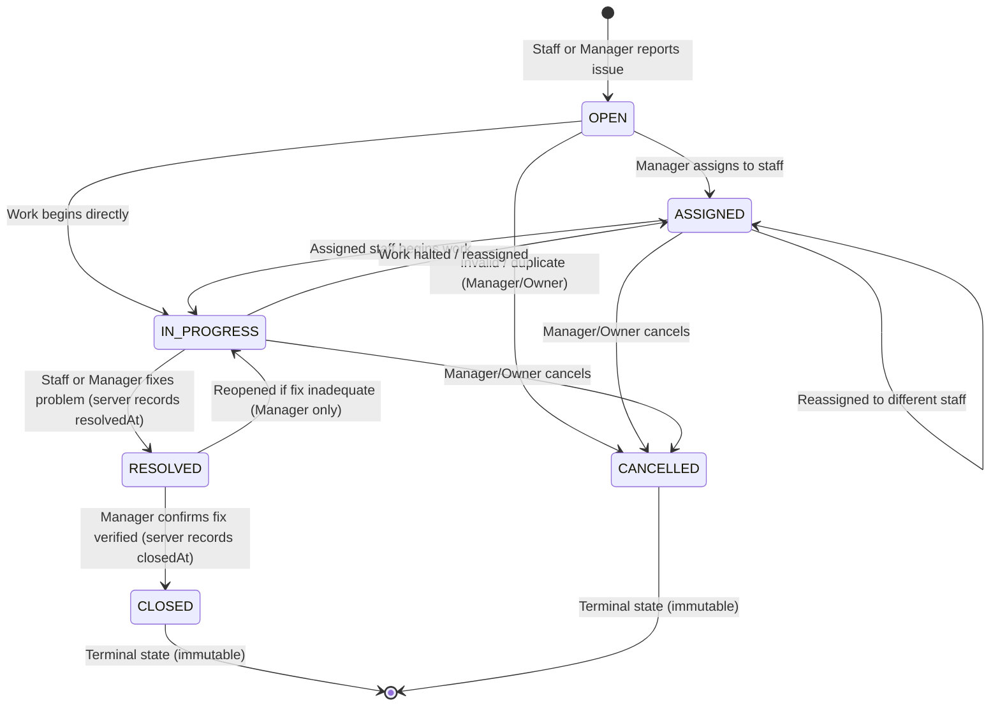
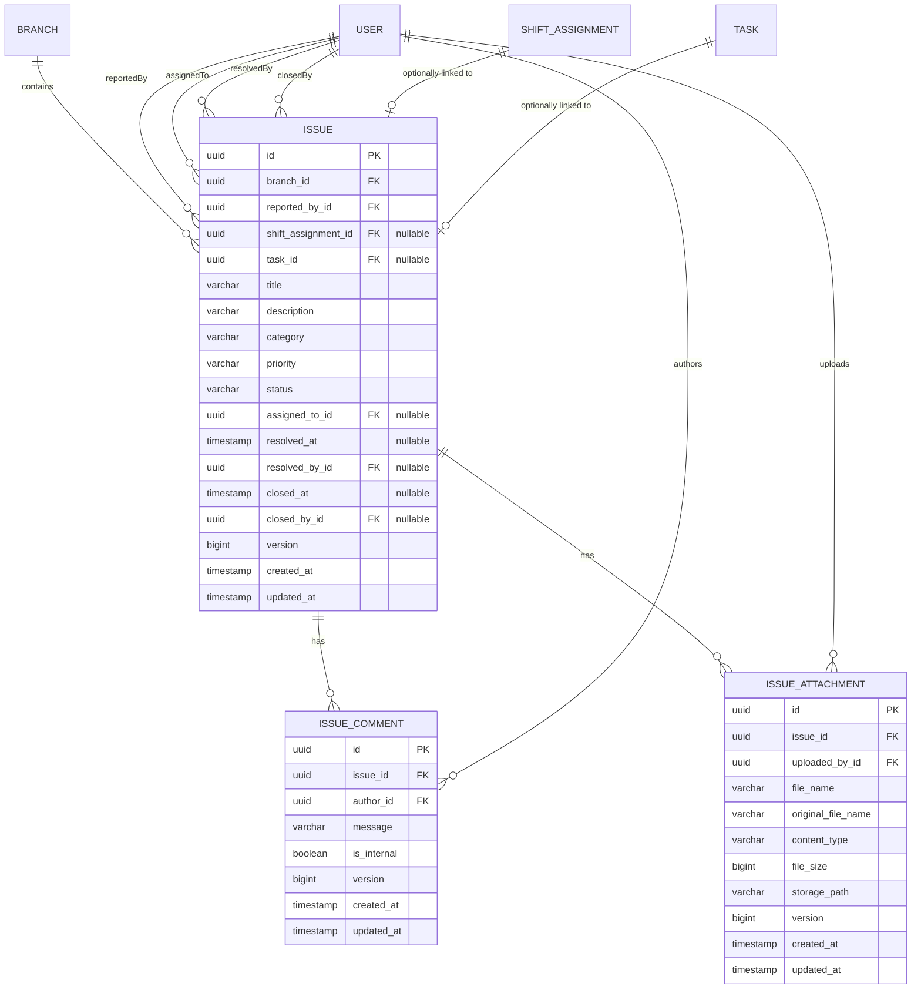

# Phase 6 Design: Issue Management

> **Module:** Issue Reporting & Resolution  
> **Status:** APPROVED FOR IMPLEMENTATION  
> **Architecture:** Spring Boot 3.4 (Java 21) + PostgreSQL 16 + React / TypeScript  

---

## 1. Core Business Purpose & Workflow

Issues represent **operational problems and hazards** discovered during daily shifts or branch operations. Small business staff frequently encounter:
- Broken equipment (e.g. espresso machine pressure drop, ice machine leak)
- Low or depleted inventory/supplies (e.g. cups, cleaning solution)
- Facility & maintenance problems (e.g. AC failure, light bulb out, restroom leak)
- Safety hazards (e.g. wet floor without sign, exposed wiring, blocked fire exit)

ShiftOps centralizes issue reporting, tracking, assignment, and resolution so problems are never lost in chat apps.

### Primary Workflow


---

## 2. Domain Entities & Relationships

### 2.1 Entity Model



### 2.2 Optional ShiftAssignment & Task Integration
- **`shiftAssignment` is optional (`nullable = true`)**: Issues frequently arise during shifts, but managers or staff outside of a shift (e.g. during opening inspection before clock-in) must also be able to report issues.
- **`task` is optional (`nullable = true`)**: If staff discovers an issue while carrying out a shift task (e.g., checklist item "Inspect Espresso Machine"), the issue can record `task_id`. This provides rich operational tracing without forcing an issue to exist for every task.
- When a task or shift assignment is removed or altered, the `Issue` remains historically valid (`ON DELETE SET NULL`).

---

## 3. Categories & Priorities

### 3.1 Categories
Fixed enumeration matching typical small business operations:
1. `EQUIPMENT` — machinery, POS systems, kitchen equipment, refrigeration
2. `MAINTENANCE` — plumbing, electrical, HVAC, doors/locks
3. `INVENTORY` — depleted stock, damaged supplies, missing materials
4. `SAFETY` — slip hazards, fire hazards, first aid, sanitation risks
5. `FACILITY` — furniture, signage, cleanliness, aesthetics
6. `OTHER` — unclassified operational issues

### 3.2 Priorities & Why `URGENT` is Necessary for MVP
- **`LOW`**: Cosmetic or minor inconvenience; can wait for weekly maintenance.
- **`NORMAL`**: Standard operational issue; resolve within 24-48 hours.
- **`HIGH`**: Impairs normal customer service or shift efficiency; resolve same day.
- **`URGENT`**: **Critical operational blocker or immediate liability**.
  - *Why URGENT is necessary in MVP*: In food service, retail, and hospitality, certain issues stop business entirely (e.g. main freezer failed risking thousands in spoiled goods; payment terminals completely down; gas smell or water pipe burst). Staff and managers need an unmistakable high-severity flag that immediately surfaces at the top of the queue and triggers visual alert badges.

---

## 4. Role Authorization Matrix

| Action | OWNER | MANAGER | STAFF |
|---|---|---|---|
| **Create Issue** | All branches | Assigned branch | Assigned branch only (reporter = self) |
| **View Issue** | All branches | Assigned branch | Own reported OR assigned to self (assigned branch only) |
| **List Issues** | All branches | Assigned branch | My issues (`/v1/issues/my`) only |
| **Assign Issue** | All branches | Assigned branch (must assign to same branch) | ❌ Forbidden (HTTP 403) |
| **Status → IN_PROGRESS** | All branches | Assigned branch | Only if assigned to self |
| **Status → RESOLVED** | All branches | Assigned branch | Only if assigned to self |
| **Status → CLOSED** | All branches | Assigned branch | ❌ Forbidden (HTTP 403) |
| **Status → CANCELLED** | All branches | Assigned branch | ❌ Forbidden (HTTP 403) |
| **Add Comment** | All branches | Assigned branch | On own reported or assigned issues |
| **Add Attachment** | All branches | Assigned branch | On own reported or assigned issues |
| **View Attachment** | All branches | Assigned branch | On own reported or assigned issues |

*Cross-Branch Isolation*: All branch access checks validate the user's primary branch via `BranchAccessService.validateBranchAccess(principal, branchId)`.

---

## 5. Storage Abstraction & Image Attachments

### 5.1 Storage Architecture
To ensure the storage layer remains replaceable without polluting domain entities:
- Interface `StorageService`:
  ```java
  public interface StorageService {
      String store(MultipartFile file, String subDirectory);
      Resource loadAsResource(String storagePath);
      void delete(String storagePath);
  }
  ```
- Default Implementation: `LocalStorageService` saving to local disk under `uploads/issues/` (configured via `app.storage.upload-dir`).
- Future Extensibility: S3, Google Cloud Storage, or MinIO can be plugged in by creating a new `@Bean StorageService` without changing `Issue` or `IssueAttachment` entities.

### 5.2 File Security & Validation Rules
1. **Size Limit**: Maximum 5 MB per file (`5 * 1024 * 1024` bytes).
2. **Allowed MIME Types**: `image/jpeg`, `image/png`, `image/webp`. Rejected with `BusinessRuleException("INVALID_FILE_TYPE")` if different.
3. **Storage Path Sanitization**: Client-supplied filename is never used as the filesystem path. Files are saved as `<uuid>.<ext>` to prevent path traversal (`../`) attacks.
4. **Original Filename Preserved**: `originalFileName` stored in database for user display.
5. **Deletion Policy**: If an issue is deleted or attachment removed, the physical file is cleaned up via `storageService.delete(...)`.

---

## 6. Comments & Audit Trail

### 6.1 `IssueComment` Entity
An issue's resolution frequently requires communication among staff and managers (e.g. "Technician called", "Spare part arriving tomorrow", "Fixed and tested").
- Threaded chronological comments preserve an immutable history.
- Comments are created via `POST /v1/issues/{id}/comments`.
- Author is strictly bound to `principal.getId()` (cannot be forged).
- `isInternal` flag allows managers to leave internal management notes if desired.

### 6.2 Audit Trail Design Decision
- An explicit `IssueStatusHistory` table is **not required for MVP**.
- The core requirements (`reportedBy`, `createdAt`, `assignedTo`, `resolvedAt`, `resolvedBy`, `closedAt`, `closedBy`, and chronological comments) provide a full operational audit trail while keeping schema complexity minimal.

---

## 7. Concurrency & Optimistic Locking

- `Issue` inherits `@Version private Long version` from `BaseEntity`.
- If two managers attempt to assign the same issue simultaneously or a staff member resolves an issue while a manager cancels it:
  - Hibernate detects the version mismatch and throws `OptimisticLockingFailureException`.
  - Spring maps this to `409 Conflict`, prompting the client to refresh and see the current state.
- `@Transactional` ensures atomicity between status changes, server-generated timestamps, and comment/activity creation.

---

## 8. Database Schema & Migration (`V6__create_issues.sql`)

```sql
-- 1. issues
CREATE TABLE issues (
    id UUID PRIMARY KEY DEFAULT gen_random_uuid(),
    branch_id UUID NOT NULL REFERENCES branches(id) ON DELETE CASCADE,
    reported_by_id UUID NOT NULL REFERENCES users(id),
    shift_assignment_id UUID REFERENCES shift_assignments(id) ON DELETE SET NULL,
    task_id UUID REFERENCES tasks(id) ON DELETE SET NULL,
    title VARCHAR(150) NOT NULL,
    description VARCHAR(2000) NOT NULL,
    category VARCHAR(30) NOT NULL,
    priority VARCHAR(20) NOT NULL DEFAULT 'NORMAL',
    status VARCHAR(20) NOT NULL DEFAULT 'OPEN',
    assigned_to_id UUID REFERENCES users(id) ON DELETE SET NULL,
    resolved_at TIMESTAMP WITH TIME ZONE,
    resolved_by_id UUID REFERENCES users(id) ON DELETE SET NULL,
    closed_at TIMESTAMP WITH TIME ZONE,
    closed_by_id UUID REFERENCES users(id) ON DELETE SET NULL,
    version BIGINT NOT NULL DEFAULT 0,
    created_at TIMESTAMP WITH TIME ZONE NOT NULL DEFAULT CURRENT_TIMESTAMP,
    updated_at TIMESTAMP WITH TIME ZONE NOT NULL DEFAULT CURRENT_TIMESTAMP,
    CONSTRAINT chk_issue_category CHECK (category IN ('EQUIPMENT', 'MAINTENANCE', 'INVENTORY', 'SAFETY', 'FACILITY', 'OTHER')),
    CONSTRAINT chk_issue_priority CHECK (priority IN ('LOW', 'NORMAL', 'HIGH', 'URGENT')),
    CONSTRAINT chk_issue_status CHECK (status IN ('OPEN', 'ASSIGNED', 'IN_PROGRESS', 'RESOLVED', 'CLOSED', 'CANCELLED'))
);

CREATE INDEX idx_issues_branch_id ON issues(branch_id);
CREATE INDEX idx_issues_status ON issues(status);
CREATE INDEX idx_issues_priority ON issues(priority);
CREATE INDEX idx_issues_reported_by ON issues(reported_by_id);
CREATE INDEX idx_issues_assigned_to ON issues(assigned_to_id);
CREATE INDEX idx_issues_created_at ON issues(created_at);

-- 2. issue_comments
CREATE TABLE issue_comments (
    id UUID PRIMARY KEY DEFAULT gen_random_uuid(),
    issue_id UUID NOT NULL REFERENCES issues(id) ON DELETE CASCADE,
    author_id UUID NOT NULL REFERENCES users(id),
    message VARCHAR(1000) NOT NULL,
    is_internal BOOLEAN NOT NULL DEFAULT FALSE,
    version BIGINT NOT NULL DEFAULT 0,
    created_at TIMESTAMP WITH TIME ZONE NOT NULL DEFAULT CURRENT_TIMESTAMP,
    updated_at TIMESTAMP WITH TIME ZONE NOT NULL DEFAULT CURRENT_TIMESTAMP
);

CREATE INDEX idx_issue_comments_issue_id ON issue_comments(issue_id);

-- 3. issue_attachments
CREATE TABLE issue_attachments (
    id UUID PRIMARY KEY DEFAULT gen_random_uuid(),
    issue_id UUID NOT NULL REFERENCES issues(id) ON DELETE CASCADE,
    uploaded_by_id UUID NOT NULL REFERENCES users(id),
    file_name VARCHAR(255) NOT NULL,
    original_file_name VARCHAR(255) NOT NULL,
    content_type VARCHAR(100) NOT NULL,
    file_size BIGINT NOT NULL,
    storage_path VARCHAR(500) NOT NULL,
    version BIGINT NOT NULL DEFAULT 0,
    created_at TIMESTAMP WITH TIME ZONE NOT NULL DEFAULT CURRENT_TIMESTAMP,
    updated_at TIMESTAMP WITH TIME ZONE NOT NULL DEFAULT CURRENT_TIMESTAMP
);

CREATE INDEX idx_issue_attachments_issue_id ON issue_attachments(issue_id);
```

---

## 9. REST API Design

All endpoints follow standard `/v1/...` prefix wrapped in `ApiResponse<T>`:

| Method | Endpoint | Description | Roles |
|---|---|---|---|
| `POST` | `/v1/issues` | Report a new issue (optional task/shiftAssignment/attachments) | ALL |
| `GET` | `/v1/issues/my` | Staff view of own reported or assigned issues | ALL |
| `GET` | `/v1/branches/{branchId}/issues` | Paged list of branch issues (filter: status, priority, category, assignee) | OWNER, MANAGER |
| `GET` | `/v1/issues/{id}` | Issue detail with comments and attachments | ALL (with branch access) |
| `PATCH` | `/v1/issues/{id}/assign` | Assign issue to staff member (`assignedToUserId`) | OWNER, MANAGER |
| `PATCH` | `/v1/issues/{id}/status` | Transition issue status | ALL (governed by state machine) |
| `POST` | `/v1/issues/{id}/comments` | Add comment / update note | ALL (with issue access) |
| `POST` | `/v1/issues/{id}/attachments` | Upload image attachment (`multipart/form-data`) | ALL (with issue access) |
| `GET` | `/v1/issues/{id}/attachments/{attachmentId}/file` | Download / view image attachment | ALL (with issue access) |

---

## 10. Edge Cases & Business Rules Verification

1. **Staff reports issue**: Reporter ID always taken from `UserPrincipal`, ignoring any client-provided reporter ID.
2. **Cross-branch issue reporting rejected**: Staff cannot report issue for branch they do not belong to (HTTP 403).
3. **Manager view own branch**: Manager can query issues for their assigned branch.
4. **Manager cannot view other branch**: Querying issues for another branch returns HTTP 403.
5. **Owner global access**: Owner can view, assign, and manage issues across all branches.
6. **Assignment to same-branch staff**: Manager can assign to active staff in the same branch.
7. **Assignment to other-branch staff rejected**: Cannot assign to staff belonging to a different branch (`BusinessRuleException("BRANCH_MISMATCH")`).
8. **Assignment to inactive staff rejected**: Cannot assign to an inactive user (`BusinessRuleException("STAFF_INACTIVE")`).
9. **Valid status transitions**: Follow state machine rules.
10. **Invalid status transitions rejected**: Arbitrary leaps like `OPEN` → `CLOSED` or modifying `CLOSED` rejected (`BusinessRuleException("INVALID_STATE_TRANSITION")`).
11. **Closed issue modification rejected**: Closed issues cannot have their status, assignee, or details altered.
12. **Server-generated timestamps**: `resolvedAt` and `closedAt` are strictly set on the backend via `clock.instant()`; client parameters are ignored.
13. **Staff cannot edit another user's issue**: Staff cannot change status of an issue assigned to someone else.
14. **Comments & attachments**: Persisted with correct author and cascade rules.
15. **Optimistic locking conflict**: Concurrent updates on the same issue version return 409 Conflict.
16. **User/Reporter deactivation**: If reporter or assignee becomes inactive, issue and history remain intact.
17. **Branch deactivation**: Existing issues remain viewable for historical audits; new issue creation blocked.
18. **Optional task link**: Issue created from a task maintains reference; task updates do not mutate the issue.
