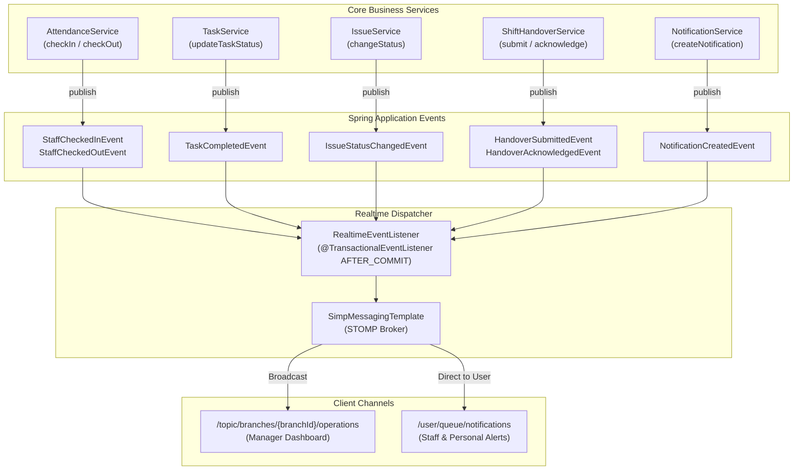

# Phase 9: Realtime / WebSocket Design Document

## 1. Overview & Business Purpose

The objective of Phase 9 is to introduce **targeted realtime updates** where operational state changes while users are actively viewing the application. ShiftOps remains a **modular monolith**; WebSockets are treated as an **optimization layer** rather than the primary source of truth or state storage.

### Core Use Cases
1. **Manager Operational Dashboard:**
   - Realtime staff check-in and check-out events (`STAFF_CHECKED_IN`, `STAFF_CHECKED_OUT`).
   - Realtime task completion and status progress (`TASK_COMPLETED`, `TASK_STATUS_CHANGED`).
   - Realtime issue reporting and status transitions (`ISSUE_STATUS_CHANGED`).
   - Realtime shift handover lifecycle notifications (`HANDOVER_SUBMITTED`, `HANDOVER_ACKNOWLEDGED`).
   - Branch announcements published in realtime (`ANNOUNCEMENT_PUBLISHED`).
2. **Staff Operational Experience:**
   - Instant notification when a task is assigned (`TASK_ASSIGNED`).
   - Instant notification when an issue relevant to the staff member is assigned or updated (`ISSUE_ASSIGNED`, `ISSUE_STATUS_CHANGED`).
   - Realtime handover debrief alerts.
   - Realtime operational announcements broadcasted to their branch or organization.
3. **Live Notification Bell & Badge:**
   - Realtime increment and badge update of unread notification count (`NOTIFICATION_CREATED`).
   - Immediate rendering of incoming notification toast/dropdown item without manual page refresh.

---

## 2. Architectural Boundaries & Non-Goals

- **Monolithic In-Process Architecture:** NO external message brokers (Kafka, RabbitMQ) or distributed caches (Redis) are introduced. Spring WebSocket with embedded in-memory STOMP message broker (`SimpleBroker`) is leveraged.
- **Decoupled Event-Driven Pipeline:** Business services do NOT call WebSocket templates directly. Business services emit standard Spring Application Events (`StaffCheckedInEvent`, `TaskCompletedEvent`, etc.).
- **Transactional Integrity:** Realtime dispatch occurs via `@TransactionalEventListener(phase = TransactionPhase.AFTER_COMMIT)` to ensure that uncommitted or rolled-back database transactions never leak realtime events.
- **WebSocket as Optimization:** The frontend continues to use TanStack Query for definitive server state. WebSocket events invalidate affected queries or apply idempotent state mutations. If WebSockets disconnect, REST APIs and background polling preserve system correctness.

---

## 3. High-Level Event Flow



---

## 4. Authentication, User Identity & Channel Authorization

### 4.1 Connection Authentication
- Handshake endpoint: `/api/ws` (with SockJS fallback support).
- Because native browser WebSocket APIs do not support custom HTTP headers during the handshake, authentication is enforced at the **STOMP protocol level** using `StompCommand.CONNECT`.
- Clients provide the JWT bearer token in the `Authorization` header (`Bearer <token>`) or `passcode`/`access_token` STOMP native headers.
- `StompAuthChannelInterceptor` intercepts inbound messages:
  1. Validates the JWT token via `JwtTokenProvider.validateToken(token)`.
  2. Extracts the `userId` and loads the `UserPrincipal` via `CustomUserDetailsService`.
  3. Constructs an authenticated `UsernamePasswordAuthenticationToken` where:
     - `Principal` is the loaded `UserPrincipal` (exposing role, primary branch, permissions).
     - `auth.getName()` returns `userPrincipal.getId().toString()` so Spring's `UserDestinationMessageHandler` can target users directly by UUID.
  4. Sets the authentication onto `StompHeaderAccessor.setUser(auth)`.
  5. Any connection attempt with a missing, expired, or malformed token is rejected with `BadCredentialsException`, sending a STOMP `ERROR` frame and closing the socket.

### 4.2 Subscription Authorization
When clients send `StompCommand.SUBSCRIBE`, `StompAuthChannelInterceptor` validates the destination against the user's role and branch scope:
1. **Branch Topic (`/topic/branches/{branchId}/operations`):**
   - Extracts the `{branchId}` UUID.
   - `OWNER`: Full visibility across all branches; allowed.
   - `MANAGER`: Allowed **only** if `user.primaryBranchId == branchId`. Attempting to subscribe to another branch throws `AccessDeniedException`.
   - `STAFF`: Forbidden from subscribing to manager operational channels; throws `AccessDeniedException`.
2. **Private Notification Queue (`/user/queue/notifications`):**
   - Any authenticated user can subscribe to their own user queue.
   - Spring automatically routes `/user/queue/notifications` to the session of the authenticated user. Direct cross-user snooping is impossible.

---

## 5. Channel & Message Specification

### 5.1 Common Envelope (`RealtimeEvent<T>`)
All messages sent over STOMP adhere to a standardized schema:

```json
{
  "eventType": "STAFF_CHECKED_IN",
  "branchId": "3fa85f64-5717-4562-b3fc-2c963f66afa6",
  "timestamp": "2026-10-08T10:15:30.000Z",
  "payload": { ... }
}
```

### 5.2 Destinations
| Destination | Audience | Event Types | Description |
|-------------|----------|-------------|-------------|
| `/topic/branches/{branchId}/operations` | OWNER, MANAGER | `STAFF_CHECKED_IN`<br/>`STAFF_CHECKED_OUT`<br/>`TASK_COMPLETED`<br/>`TASK_STATUS_CHANGED`<br/>`ISSUE_STATUS_CHANGED`<br/>`HANDOVER_SUBMITTED`<br/>`HANDOVER_ACKNOWLEDGED`<br/>`ANNOUNCEMENT_PUBLISHED` | High-level operational events for live manager dashboards. |
| `/user/queue/notifications` | Specific User | `NOTIFICATION_CREATED` | Personal notification payload containing `NotificationResponse` + live `unreadCount`. |

---

## 6. Frontend Architecture & Resilience

### 6.1 WebSocket Client Service (`useWebSocket`)
- Built using lightweight STOMP client (or native WebSocket with STOMP protocol framing / `@stomp/stompjs`).
- State machine: `DISCONNECTED` ⇄ `CONNECTING` ⇄ `CONNECTED` ⇄ `RECONNECTING`.
- Lifecycle:
  - Connects automatically upon authenticated login using current `accessToken`.
  - Disconnects cleanly on user logout.
  - Subscribes to `/user/queue/notifications` for all users.
  - Subscribes to `/topic/branches/{branchId}/operations` when managers/owners are active on the dashboard.
  - Exponential backoff reconnection with jitter (1s, 2s, 4s, up to max 15s).

### 6.2 TanStack Query Integration & Idempotency
- When `NOTIFICATION_CREATED` is received:
  - TanStack Query cache `['notifications', 'unread-count']` is updated immediately with `payload.unreadCount`.
  - TanStack Query cache `['notifications', 'my']` is invalidated to fetch the latest inbox page.
- When `STAFF_CHECKED_IN` or `STAFF_CHECKED_OUT` is received:
  - Queries `['attendance']` and `['shifts']` are invalidated, refreshing dashboard tables without page reload.
- When `TASK_COMPLETED` is received:
  - Queries `['tasks']` and `['handovers']` are invalidated.
- When `ISSUE_STATUS_CHANGED` is received:
  - Query `['issues']` is invalidated.
- Duplicate event safety: Cache invalidation queries are idempotent; receiving an event twice triggers a standard query refetch without corrupting client state.

---

## 7. Observability & Metrics

A dedicated `WebSocketMetrics` component tracks:
- `activeConnections` (`AtomicInteger`): Monitored through Spring's `SessionConnectedEvent` and `SessionDisconnectEvent`.
- `connectionFailures` (`AtomicLong`): Incremented on invalid tokens or handshake rejections.
- `eventBroadcastFailures` (`AtomicLong`): Incremented if message conversion or dispatch fails.
- Key lifecycle events are logged at `INFO` and `WARN` levels.

---

## 8. Limitations & Future Extensions

- **Single-Node In-Memory Broker:** The current architecture uses Spring's `SimpleBroker`. If ShiftOps is horizontally scaled to multiple backend instances in a future phase, a STOMP broker relay (such as RabbitMQ or Redis pub/sub) would be required to synchronize broadcasts across nodes.
- **Message History:** WebSockets provide ephemeral streaming. Historical catch-up is handled through REST query endpoints (`/v1/notifications/my`, `/v1/attendance`, etc.) upon connection and reconnection.
